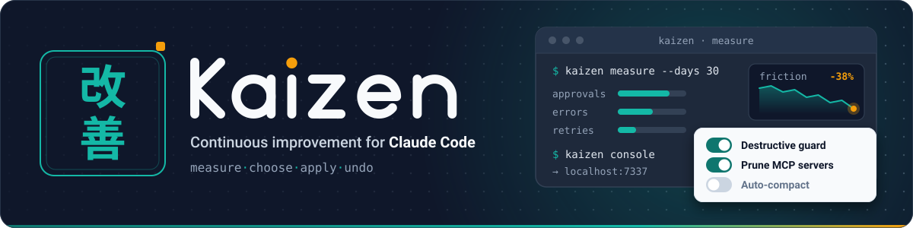
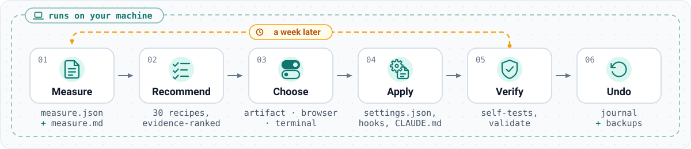
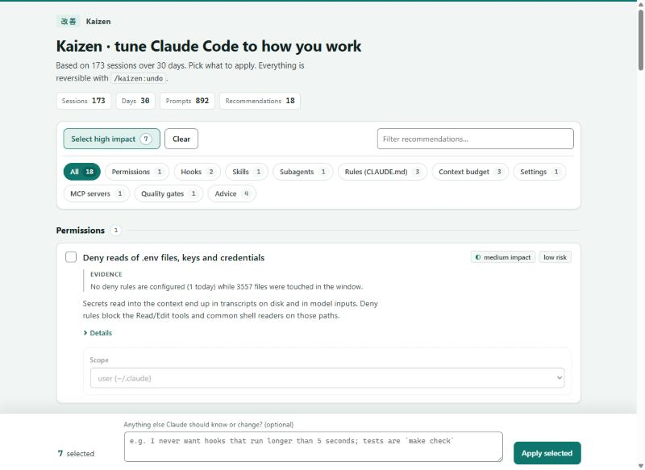

<p align="center">
  
</p>

<h1 align="center">Kaizen for Claude Code</h1>

<p align="center">
  <b>/insights that acts.</b> Measures how you really work with Claude Code, lets you pick fixes in an interactive console, then configures hooks, skills, subagents, rules and permissions for you. Reversible. Local-only. English and Russian.
</p>

<p align="center">
  <a href="https://github.com/KROU4/claude-kaizen/actions/workflows/ci.yml"></a>
  
  
  
  <a href="README.ru.md"></a>
</p>

---

Claude Code's built-in `/insights` tells you where your sessions go wrong. Then it leaves you to write the hooks, rules and allowlists yourself. **Kaizen closes that loop:**

```
measure  →  recommend  →  you choose  →  apply  →  verify  →  (undo)  →  measure again in a week
```

<p align="center">
  
</p>

## What it does

| Stage | What happens | Where |
|---|---|---|
| **Measure** | Streams every transcript in `~/.claude/projects` (1 GB ≈ 10 s), reads `/insights` facets when present, inventories your settings, hooks, skills, agents, plugins and MCP servers. Produces `measure.json` and a 200-line digest `measure.md`. | `node scripts/kaizen.mjs measure` |
| **Recommend** | Evaluates 30 evidence-based recipes against the measurement. Each recommendation carries the exact numbers that triggered it. | `… recommend` |
| **Choose** | An interactive console: in the Claude desktop app it is a live artifact Claude reads back; in a terminal it is a local web page; over SSH it falls back to multiple-choice questions. | `… console` |
| **Apply** | Writes hooks into `settings.json`, installs hook scripts, adds permission rules, creates skills and subagents, inserts marked blocks into `CLAUDE.md`, removes dead MCP servers — every write journaled with a backup. | `… apply` |
| **Verify** | Self-tests every installed hook and the status line, parses every touched file, checks CLAUDE.md markers; the `kaizen-verifier` agent adds skill/agent validation. | `… verify` |
| **Undo** | Reverts a batch exactly, leaving anything you edited afterwards alone. | `… undo` |

Everything runs on your machine. The only thing a model ever sees is the digest, and the digest is secret-scrubbed.

## Install

**As a plugin** (recommended; adds `/kaizen:*` skills, three subagents and a weekly reminder):

```
/plugin marketplace add KROU4/claude-kaizen
/plugin install kaizen@claude-kaizen
```

Then, in any session:

```
/kaizen:start
```

**As an agent kit** (nothing to install — paste this into Claude Code):

> Clone https://github.com/KROU4/claude-kaizen into a temporary folder, read its `AGENTS.md`, and run the Kaizen cycle for me.

**From the shell** (no Claude needed for the numbers):

```bash
git clone https://github.com/KROU4/claude-kaizen && cd claude-kaizen
node scripts/kaizen.mjs measure        # digest to stdout, files in ~/.claude/kaizen/
node scripts/kaizen.mjs recommend      # what the data says you should change
node scripts/kaizen.mjs console        # pick in the browser → choices.json
node scripts/kaizen.mjs apply          # journaled, reversible
node scripts/kaizen.mjs verify         # self-test what was installed
node scripts/kaizen.mjs undo --last
```

Run `measure` again a week later: the digest ends with a **what moved** table (interruptions, permission prompts, timeouts, compactions, corrections, cost…) comparing the two measurements.

Requirements: Node.js 18+ and Claude Code with some history (transcripts live for `cleanupPeriodDays`, 30 by default).

## The console

<p align="center">
  
</p>

Recommendations are grouped by category with their evidence, impact and risk. Tick what you want, adjust parameters (which formatter, deny or ask, which MCP servers), add a note for Claude ("tests are `make check`"), press **Apply**. In the Claude desktop app the page is a published artifact backed by its database, so Claude reads your choices without you pasting anything. In a plain terminal it is a page on `127.0.0.1` that writes `choices.json` and exits.

## Recipes

The catalog lives in [`recipes/catalog.json`](recipes/catalog.json); the generated reference is [`docs/recipes.md`](docs/recipes.md). Each recipe has a trigger over measured metrics, bilingual explanations, parameters, actions and an automatic undo. Highlights:

- **Permissions** — a read-only allowlist generated from the commands you actually repeat (the `/fewer-permission-prompts` algorithm, with scope choice and interpreter blocklist); deny rules for `.env`, keys and SSH material; `acceptEdits` when you never reject edits.
- **Hooks** — destructive-command guard, secret-file guard, format-on-edit (only when the formatter is installed), verify-before-stop (sends Claude back once when code changed without a test run), desktop/Telegram notifications, session-start git context, pre-compaction handoff notes, long-command nudge.
- **Rules (CLAUDE.md)** — language, read-before-edit, autonomy, verification, and rules distilled from your own corrections, each in a marked block.
- **Skills and subagents** — a skill from your most repeated prompt, a read-only `code-reviewer`, a Haiku `test-runner` that keeps logs out of your context.
- **Context budget** — unused MCP servers (removed with backup), plugins none of whose skills you use, oversized CLAUDE.md, compaction pressure.
- **Advice** — failing or slow hooks (with the culprit's name), model routing for subagents, plan mode, what `/insights` says breaks most.

Propose a recipe with the [recipe issue template](.github/ISSUE_TEMPLATE/recipe_proposal.md).

## What gets measured

Sessions, prompts and tools per session · interactive permission prompts vs auto-accepted · rejections, interruptions, corrections · compactions and peak prompt size · tool errors by class (timeouts, edit mismatches, not-found, test failures…) · slow and repeated commands · hooks: runs, failures, latency per hook · subagent and skill usage · MCP servers configured vs used · installed vs invoked skills and plugins · CLAUDE.md load in tokens · tests per commit, destructive commands, force pushes · working hours, prompt length, repeated prompt openings · model mix and reported cost · `/insights` friction, outcome and satisfaction labels when available.

Full list with definitions: [`docs/recipes.md#metrics-recipes-can-test`](docs/recipes.md).

## Privacy

- Nothing leaves your machine. There is no telemetry, no network call except the optional Telegram notification hook you configure yourself.
- The digest keeps counts and short, secret-scrubbed snippets of your own prompts (needed to spot repeated instructions). Tool output and Claude's replies are never retained.
- State lives in `~/.claude/kaizen/` (override with `KAIZEN_STATE_DIR`). Delete the folder to forget everything.
- Every change is journaled under `~/.claude/kaizen/applied/<batch>/` with backups of the files it touched.

## How it compares

Kaizen was built after reading ~60 related projects ([docs/prior-art.md](docs/prior-art.md)). The analysis side is crowded (`/insights`, sniffly, ccusage, claude-code-doctor); the writing side is a set of single-surface tools (claude-reflect → CLAUDE.md, cc-safe-setup → hooks, `/fewer-permission-prompts` → allowlist, ccstatusline → status line). Kaizen is the loop: evidence → reviewed, reversible, multi-surface changes → measured again. Zero dependencies, Node only, Windows/macOS/Linux.

## Repository layout

```
.claude-plugin/     plugin.json, marketplace.json (install from this repo)
skills/             /kaizen:start  measure  apply  undo  status  recipes
agents/             kaizen-analyst, kaizen-smith, kaizen-verifier
hooks/              plugin hook: weekly SessionStart reminder
scripts/            kaizen.mjs CLI + lib/ (scanner, metrics, recipes, apply, console)
recipes/            catalog.json + templates/ (hook scripts, rules, agents, status line)
console/            the interactive page (vanilla HTML, offline)
locales/            en.json, ru.json
docs/               recipes.md (generated), reference/, prior-art.md, assets/
tests/              node --test, synthetic fixtures only
```

## Contributing

`node scripts/kaizen.mjs selfcheck && npm test` must pass. Recipes need `en` and `ru` text, a trigger, evidence and working undo. See [CONTRIBUTING.md](CONTRIBUTING.md).

## License

[MIT](LICENSE)
