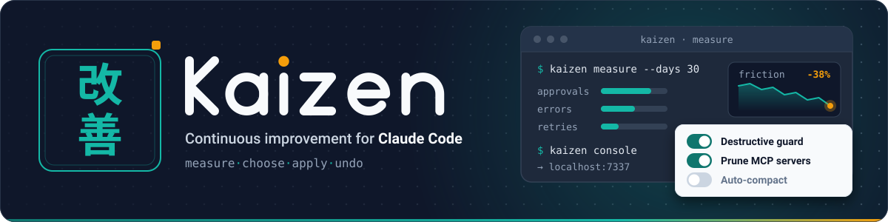
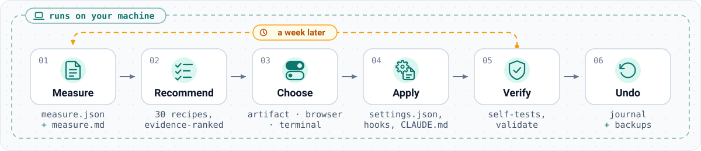
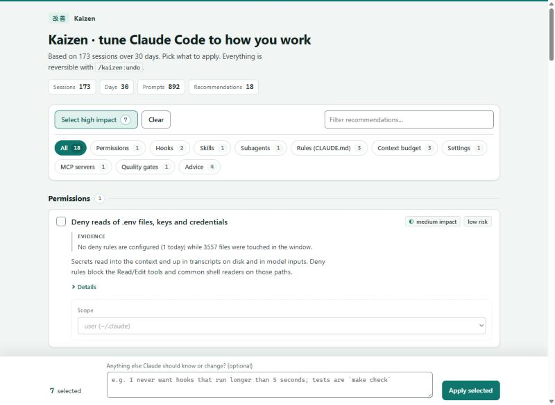

<p align="center">
  
</p>

<h1 align="center">Kaizen для Claude Code</h1>

<p align="center">
  <b>/insights, который действует.</b> Измеряет, как вы на самом деле работаете с Claude Code, даёт выбрать исправления в интерактивной консоли, а затем настраивает за вас хуки, скиллы, субагенты, правила и разрешения. Обратимо. Только локально. На английском и русском.
</p>

<p align="center">
  <a href="https://github.com/KROU4/claude-kaizen/actions/workflows/ci.yml"></a>
  
  
  
  <a href="README.md"></a>
</p>

---

Встроенная в Claude Code команда `/insights` показывает, где в ваших сессиях что-то идёт не так. А писать хуки, правила и allowlist (список разрешённых команд) приходится вам самим. **Kaizen замыкает этот цикл:**

```
measure  →  recommend  →  you choose  →  apply  →  verify  →  (undo)  →  measure again in a week
```

<p align="center">
  
</p>

## Что делает Kaizen

| Этап | Что происходит | Чем выполняется |
|---|---|---|
| **Измерение** | Потоково обрабатывает каждый транскрипт в `~/.claude/projects` (1 GB ≈ 10 s), считывает фасеты `/insights`, если они есть, и составляет перечень ваших настроек, хуков, скиллов, агентов, плагинов и MCP-серверов. Создаёт `measure.json` и дайджест `measure.md` на 200 строк. | `node scripts/kaizen.mjs measure` |
| **Рекомендации** | Оценивает по результатам измерения 31 рецепт в 12 категориях, каждый основан на данных. Каждая рекомендация сопровождается точными числами, из-за которых она появилась. | `… recommend` (`--add FILE` — дополнительные рецепты) |
| **Выбор** | Интерактивная консоль: в приложении Claude для рабочего стола это живой артефакт, из которого Claude сам считывает ваш выбор; в терминале — локальная веб-страница; по SSH вместо неё используются вопросы с вариантами ответа. | `… console`, `… choices --import FILE` |
| **Применение** | Прописывает хуки в `settings.json`, устанавливает скрипты хуков, добавляет правила разрешений, создаёт скиллы и субагенты, вставляет помеченные блоки в `CLAUDE.md`, удаляет неиспользуемые MCP-серверы. Каждая запись заносится в журнал вместе с резервной копией. | `… apply` (`--param`, `--param-file рецепт.имя=путь`, `--add FILE`) |
| **Проверка** | Запускает самотест каждого установленного хука и строки состояния, разбирает файлы настроек, в которые он писал (`--project` добавляет `.claude/settings*.json` проекта), проверяет маркеры блоков в CLAUDE.md. `~/.claude.json`, созданные скиллы и субагенты проверяет агент `kaizen-verifier`. | `… verify` |
| **Откат** | Точно откатывает пакет изменений и не трогает то, что вы правили позже (`--force` откатывает и это, предварительно сохранив копию). | `… undo` |

Всё выполняется на вашем компьютере; единственное исключение — необязательная консоль-артефакт в приложении для рабочего стола (см. [Конфиденциальность](#конфиденциальность)). Единственное, что видит модель, — дайджест (и короткие очищенные фрагменты запросов рядом с ним); ни один из агентов не читает ваши транскрипты напрямую.

## Установка

**Как плагин** (рекомендуется; добавляет скиллы `/kaizen:*`, три субагента и еженедельное напоминание):

```
/plugin marketplace add KROU4/claude-kaizen
/plugin install kaizen@claude-kaizen
```

Затем в любой сессии:

```
/kaizen:start
```

**Как набор для агента** (ничего устанавливать не нужно — вставьте это в Claude Code):

> Склонируй репозиторий https://github.com/KROU4/claude-kaizen во временную папку, прочитай его `AGENTS.md` и запусти для меня цикл Kaizen.

**Из командной строки** (чтобы получить цифры, Claude не нужен):

```bash
git clone https://github.com/KROU4/claude-kaizen && cd claude-kaizen
node scripts/kaizen.mjs measure        # дайджест в stdout, файлы в ~/.claude/kaizen/
node scripts/kaizen.mjs recommend      # что, судя по данным, стоит изменить
node scripts/kaizen.mjs console        # выбор в браузере → choices.json
node scripts/kaizen.mjs choices --import my-choices.json   # проверить файл выбора (свой или полученный из артефакта)
node scripts/kaizen.mjs apply          # с журналом, обратимо
node scripts/kaizen.mjs apply --recipe claude-md.corrections --param-file claude-md.corrections.rules=rules.txt   # многострочное значение из файла
node scripts/kaizen.mjs verify         # самопроверка установленного (--project DIR для проектной области)
node scripts/kaizen.mjs undo --last
```

Или без клонирования, прямо с GitHub (закрепите тег, чтобы запуски были повторяемыми):

```bash
npx github:KROU4/claude-kaizen#v0.1.4 measure
npx github:KROU4/claude-kaizen#v0.1.4 recommend
```

Запустите `measure` ещё раз через неделю: дайджест завершится таблицей **что изменилось** (прерывания, запросы разрешений, таймауты, компакции, исправления, стоимость…) со сравнением двух измерений.

Требования: Node.js 18+ и Claude Code, в котором уже есть история сессий (срок хранения транскриптов задаёт `cleanupPeriodDays`, по умолчанию 30 дней).

## Консоль

<p align="center">
  
</p>

Рекомендации сгруппированы по категориям, у каждой указаны основание, эффект и риск. Отметьте нужные, настройте параметры (какой форматировщик, deny или ask, какие MCP-серверы), добавьте заметку для Claude («тесты запускаются через `make check`») и нажмите **Применить выбранное**. В приложении Claude для рабочего стола страница — это опубликованный приватный артефакт с собственной базой данных, поэтому Claude читает ваш выбор (после вашего ответа «готово» в чате) без копирования и вставки, показывает выбранное и просит подтверждение перед применением. В обычном терминале это страница на `127.0.0.1`, которая записывает `choices.json` и завершает работу.

## Рецепты

Каталог находится в [`recipes/catalog.json`](recipes/catalog.json); сгенерированный справочник — [`docs/recipes.md`](docs/recipes.md). У каждого рецепта есть условие срабатывания по измеряемым метрикам, пояснения на двух языках, параметры, действия и автоматический откат. Основное:

- **Разрешения** — allowlist команд только для чтения, построенный по командам, которые вы действительно повторяете (алгоритм `/fewer-permission-prompts` с выбором области и чёрным списком интерпретаторов); правила deny для `.env`, ключей и файлов SSH; `acceptEdits`, если вы никогда не отклоняете правки.
- **Хуки** — защита от разрушительных команд, защита файлов с секретами, format-on-edit (только если форматировщик установлен), verify-before-stop (один раз возвращает Claude к работе, если код изменился, а тесты не запускались), уведомления на рабочем столе и в Telegram, git-контекст при старте сессии, заметки-передачи перед компакцией, подсказка о долгих командах.
- **Правила (CLAUDE.md)** — язык, read-before-edit, автономность, проверка и правила, выведенные из ваших собственных исправлений; каждое в помеченном блоке.
- **Скиллы и субагенты** — скилл из запроса, который вы повторяете чаще всего, `code-reviewer` только для чтения, `test-runner` на Haiku, который не пускает логи в ваш контекст.
- **Бюджет контекста** — неиспользуемые MCP-серверы (удаляются с резервной копией), плагины, ни один из скиллов которых вы не используете, разросшийся CLAUDE.md, частые компакции.
- **Советы** — падающие и медленные хуки (с указанием виновника), выбор моделей для субагентов, режим плана, то, что по данным `/insights` ломается чаще всего.

Предложить рецепт можно через [шаблон issue для рецептов](.github/ISSUE_TEMPLATE/recipe_proposal.md).

## Что измеряется

Сессии, запросы и вызовы инструментов на сессию · интерактивные запросы разрешений и принятые автоматически · отклонения, прерывания, исправления · компакции и пиковый размер промпта · ошибки инструментов по классам (таймауты, несовпадения при правке, «не найдено», падения тестов…) · медленные и повторяющиеся команды · хуки: запуски, сбои, задержка по каждому хуку · использование субагентов и скиллов · настроенные и используемые MCP-серверы · установленные и вызванные скиллы и плагины · нагрузка от CLAUDE.md в токенах · тесты на коммит, разрушительные команды, force-push · рабочие часы, длина запроса, повторяющиеся начала запросов · состав моделей и указанная в данных стоимость · метки трения, исхода и удовлетворённости из `/insights`, если они есть.

Полный список с определениями: [`docs/recipes.md#metrics-recipes-can-test`](docs/recipes.md).

## Конфиденциальность

- Ничего не покидает ваш компьютер, кроме двух необязательных случаев. Телеметрии нет; сетевые вызовы — только необязательный хук уведомлений в Telegram, который вы настраиваете сами, и консоль-артефакт (ниже).
- **Консоль-артефакт (только приложение для рабочего стола).** Страница публикуется как приватный артефакт claude.ai: рекомендации входят в страницу, а ваши отметки, параметры и заметка хранятся в базе данных артефакта, пока Claude их не прочитает и не удалит документ. Не делитесь ссылкой и не вводите там секреты (токен Telegram-бота Claude запросит в чате). Локальная консоль в браузере и терминальный режим ничего не загружают.
- В дайджесте хранятся счётчики и короткие фрагменты ваших собственных запросов, очищенные от секретов (они нужны, чтобы находить повторяющиеся инструкции). Вывод инструментов и ответы Claude не сохраняются никогда.
- Состояние хранится в `~/.claude/kaizen/` (путь можно переопределить через `KAIZEN_STATE_DIR`). Удалите папку, и Kaizen забудет всё.
- Каждое изменение записывается в журнал в `~/.claude/kaizen/applied/<batch>/` вместе с резервными копиями затронутых файлов.

Подробнее: [FAQ](docs/faq.md), [заметки об архитектуре](docs/architecture.md) и [справочник форматов Claude Code](docs/reference/claude-code-formats.md) (на английском).

## Сравнение с аналогами

Kaizen создан после изучения ~60 смежных проектов ([docs/prior-art.md](docs/prior-art.md)). Инструментов для анализа много (`/insights`, sniffly, ccusage, claude-code-doctor); инструменты, которые вносят изменения, — это набор решений, каждое из которых работает с одной областью (claude-reflect → CLAUDE.md, cc-safe-setup → хуки, `/fewer-permission-prompts` → allowlist, ccstatusline → строка состояния). Kaizen — это замкнутый цикл: данные → просмотренные вами, обратимые изменения сразу в нескольких областях → повторное измерение. Без зависимостей, только Node, Windows/macOS/Linux.

## Структура репозитория

```
.claude-plugin/     plugin.json, marketplace.json (установка из этого репозитория)
skills/             /kaizen:start  measure  apply  undo  status  recipes
agents/             kaizen-analyst, kaizen-smith, kaizen-verifier
hooks/              хук плагина: еженедельное напоминание при SessionStart
scripts/            kaizen.mjs CLI + lib/ (сканер, метрики, рецепты, применение, консоль)
recipes/            catalog.json + templates/ (скрипты хуков, правила, агенты, строка состояния)
console/            интерактивная страница (чистый HTML, работает без сети)
locales/            en.json, ru.json
docs/               recipes.md (генерируется), reference/, prior-art.md, assets/
tests/              node --test, только синтетические тестовые данные
```

## Участие в разработке

Команда `node scripts/kaizen.mjs selfcheck && npm test` должна завершаться успешно. Рецептам нужны тексты на `en` и `ru`, условие срабатывания, основание и работающий откат. См. [CONTRIBUTING.md](CONTRIBUTING.md).

## Лицензия

[MIT](LICENSE)
