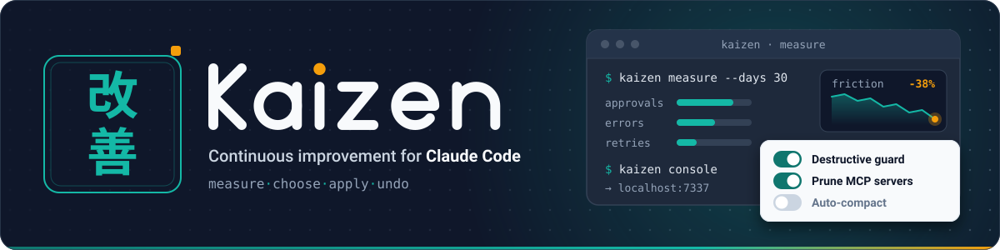
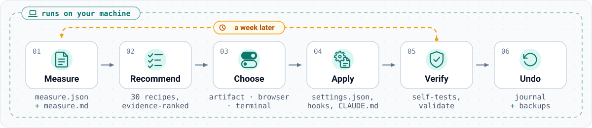
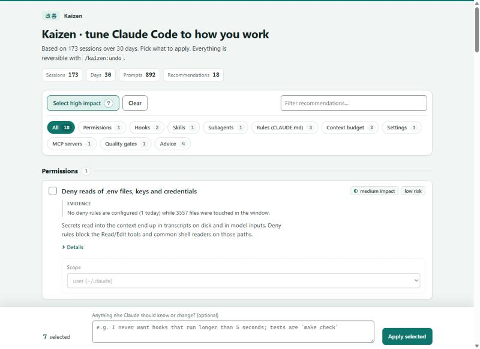

Claude Code's built-in `/insights` tells you where your sessions go wrong, then leaves the fixing to you. **Kaizen closes that loop.** It reads your local transcripts, shows the numbers, lets you pick fixes in an interactive console, applies them reversibly and checks that they work.



## Start in one minute

Inside Claude Code:

```
/plugin marketplace add KROU4/claude-kaizen
/plugin install kaizen@claude-kaizen
/kaizen:start
```

No install at all: ask Claude Code to *"clone https://github.com/KROU4/claude-kaizen into a temporary folder, read its AGENTS.md and run the Kaizen cycle for me"*.

Just the numbers, from a shell:

```bash
npx github:KROU4/claude-kaizen#v0.1.8 measure
npx github:KROU4/claude-kaizen#v0.1.8 recommend
```

## What it does

| Stage | What happens |
|---|---|
| **Measure** | Streams `~/.claude/projects` transcripts (about 1 GB in 10 s, cached), the `/insights` facets and your configuration into 60+ metrics and a bilingual digest. |
| **Recommend** | 31 recipes in 12 categories, each triggered by measured numbers and showing the evidence. |
| **Choose** | An interactive console: a private claude.ai artifact that Claude reads back, a local web page, or plain questions. |
| **Apply** | Journaled, idempotent writes to settings, hook scripts, skills, subagents, `CLAUDE.md` blocks, MCP and plugin toggles. |
| **Verify** | Self-tests every installed hook and the status line, parses the settings files it wrote. |
| **Undo** | Reverts a batch exactly and leaves anything you edited afterwards alone. |



## Read more

- [Recipe catalog](recipes.md): every recipe, its trigger and its actions.
- [Architecture](architecture.md): modules, data flow, the journal.
- [FAQ](faq.md): privacy, what the model sees, how undo works.
- [Prior art](prior-art.md): what exists already and where Kaizen differs.
- [Claude Code formats](reference/claude-code-formats.md): the settings, hook and transcript formats Kaizen reads and writes.
- [Source, issues and releases on GitHub](https://github.com/KROU4/claude-kaizen) · [README на русском](https://github.com/KROU4/claude-kaizen/blob/main/README.ru.md)
